# Matte Refine for Flame: user guide

This guide covers the matte operations: what each one does, when to use it, its controls and
what to watch for. Installing is covered in `README.md`.

Matte Refine starts from a matte that is already good, from a keyer, roto, LTX Alpha Gen or
anything else, and fixes its defects. It does not pull a new matte from the picture.

## Contents

1. [The nodes and how to connect them](#1-the-nodes-and-how-to-connect-them)
2. [Matte Refine: the operations](#2-matte-refine-the-operations)
3. [Matte Refine ML: the operations](#3-matte-refine-ml-the-operations)
4. [Try it yourself: the test scenes](#4-try-it-yourself-the-test-scenes)
5. [Which operation do I need?](#5-which-operation-do-i-need)

About the pictures: every before / after image in this guide was made from the synthetic test
scenes (section 4) with the plugins' own code. The settings are given under each image. Mattes
are shown as grey. Where an image has a thin red line, that line is the true edge of the scene,
so you can see whether an operation moved the edge towards it or away from it. Zoomed crops show
the pixels as blocks on purpose. The test scenes are simple drawn shapes, not real footage.
Real footage decides how good an operation is on your shot, and on hair in particular.

---

## 1. The nodes and how to connect them

Both nodes are in Batch under **Matte Refine**.

| Node | What it holds | Speed |
|---|---|---|
| **Matte Refine** | Eight classical operations: clean-up, hole filling, edge shape, edge colour | Real time. Every frame renders live as you scrub. |
| **Matte Refine ML** | Operations driven by machine-learning models: Edge Refine and Smart Fill | Live as well, but needs an NVIDIA GPU. About 0.1-0.3 s per HD frame. |

A third node, **Matte Merge**, is planned but not built yet. It will combine a main matte with an
LTX Alpha Gen hair-detail matte, keeping the main matte and adding only the hair near its edge.

In both nodes each operation is its own column with an **Enable** switch. The enabled operations
run in a fixed order, left to right in the node, and each one works on the result of the one
before. You cannot change the order. Each node has a **matte output**, which always carries
the refined matte, and an **image output**, which shows whatever the **View** control picks.

Pixel sizes (every control ending in "px") are in pixels of the full-resolution frame. When
Flame renders a proxy they are scaled with it, so the result looks the same.

### Matte Refine: inputs

- **Front (the picture): optional.** Only Snap to Image and Edge Colour Unmix need it. They
  also need it to be the same size as the matte.
- **Matte: the node's Matte input**, an extra socket on the node. If nothing is connected to it,
  the node reads the matte from the **alpha of the front input** instead (Flame's source alpha
  socket). Use one of the two.
- The output frame takes its size from the matte, so the node works with only a matte connected.

What the footer tells you:

| Footer message | Meaning |
|---|---|
| *No matte: connect the matte to the Matte input.* | No matte arrived. |
| *The input matte is constant 1.00: connect the matte to the Matte input.* | The matte is the same value everywhere. Usually nothing is connected and Flame delivers a solid alpha. |
| *The picture and the matte differ in size: the picture is not used.* | Snap to Image and Edge Colour Unmix switch off. |
| *Snap to Image and Edge Colour Unmix need the picture on the front input.* | One of those is on, but there is no picture. |
| *Only 32-bit float images are supported.* | Set the input to 32-bit float. |

Order of the operations: **Clean & Crush → Fill Holes → Solid Core → Contour Smooth → Shrink /
Grow → Edge Width → Snap to Image → Edge Colour Unmix.**

The node has two tabs, with six columns on each. The first tab holds Matte, Clean & Crush,
Fill Holes, Fill Holes Edges, Solid Core and Support. The second tab holds Matte, Contour
Smooth, Shrink / Grow, Edge Width, Snap to Image and Edge Colour Unmix. The Matte column (View,
Version) appears on both tabs, and its View stays the same on both.

### Matte Refine ML: inputs

Wire it like LTX Alpha Gen:

- **Front (the picture): required.** The models look at the picture.
- **Matte: the node's second socket, the source alpha.** The matte arrives as the alpha of the
  front clip.

| Footer message | Meaning |
|---|---|
| *No picture.* | Nothing on the front. |
| *The picture has no alpha, so there is no matte: connect the matte to the node's second socket (source alpha).* | The matte is missing. |
| *The input matte is constant ...: no matte on the source alpha. ...* | The matte is the same everywhere; usually nothing is connected. |
| *Edge Refine runs on the CPU (slow): ...* / *Smart Fill runs on the CPU (slow): ...* | No usable GPU. It still works, but about ten times slower. |
| *Temporal: ... The matte passes through this step.* / *Smart Fill: ... The matte passes through this step.* / *Edge Refine: ... The matte passes through.* | Something failed: a missing model, no runner, or a timeout. The node outputs the matte it received, unchanged, and tries again on the next frame. |

Order of the operations: **Temporal → Smart Fill → Edge Refine.** There is one tab, with five columns:
Matte, Temporal, Smart Fill, Edge Refine, Model & Support.

---

## 2. Matte Refine: the operations

Two rules hold for every operation in this node:

- **Only what it is meant to fix changes.** Pixels an operation has no business with keep their
  exact value, down to the last bit.
- **Most operations work in one direction only.** Fill Holes and Solid Core never darken a
  pixel. Clean & Crush never brightens one. Grow never lowers a pixel and Shrink never raises one.

Every operation except Fill Holes is **off** when you add the node. Fill Holes is **on** by
default.

### Clean & Crush

**What it does.** It removes small islands and specks outside the subject, together with their
soft fringe. It also crushes the faint haze in the background to exactly 0. Everything more than
a few pixels outside the edge goes to 0, with a soft fade. This is the mirror image of Solid Core.

**Never touches:** the subject itself, and any piece larger than Max Island %, which counts as a
separate object. It never brightens a pixel.

**When to use it:** a keyed matte with dirt in the background, sensor noise or a grey veil
behind the subject, or debris from a model.

| Control | Default | Range | What it does |
|---|---|---|---|
| Enable | off | | Turns the operation on or off. |
| Max Island % | 0.05 | 0-10 | Islands up to this share of the frame's area are removed. 0 keeps all islands; Crush still applies. |
| Background Below | 0.15 | 0.01-0.5 | Matte below this value counts as background or haze. Islands, and the edge the crush starts from, are measured at this level. |
| Crush Beyond px | 4 | 0-100 | Everything farther than this outside the edge becomes 0. 0 = no crush. |
| Crush Feather px | 2 | 0-20 | The crush fades in over this many pixels. |

Tips:
- A piece you want to keep, such as a ball or a second person, survives as long as it is larger
  than Max Island %. If a large piece of debris stays, raise Max Island % just above its size.
  Analyze Frame tells you that size.
- If the haze is brighter than 0.15, the haze itself counts as matte. It then joins islands to
  the subject and nothing is removed. Raise Background Below above the haze level.
- **Watch for** semi-transparent parts of the subject below Background Below that sit outside
  its solid edge, such as glass, smoke or very fine hair tips: the crush removes them. Raise
  Crush Beyond px to protect them, or set it to 0 and use only the island removal.

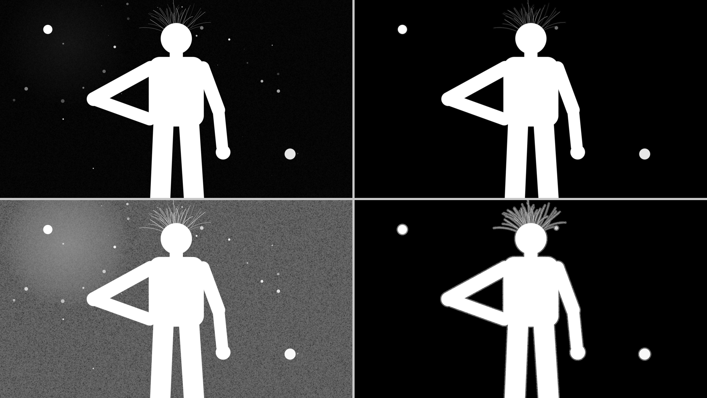

*Scene `specks`, Clean & Crush with its default settings. Top row: input | result. Bottom row:
the same, shown brightened so the faint haze is visible. 29 islands were removed, and the two
large discs (about 0.1 % of the frame) were kept as objects. The haze is gone except within
4 px of the edge (the thin halo around the figure in the brightened result).*

### Fill Holes

**What it does.** It fills holes inside the subject with solid white (1.0). Those are the specks
and gaps a keyer or a model leaves in the middle of a subject. A hole is any area below **Solid
Above** that is completely surrounded by solid matte. Because it only fills enclosed areas, it
leaves the outer edge alone, which is the difference from a dilate or a close.

**Never touches:** the outer edge and the background, that is, everything connected to an open
frame edge. Holes larger than Max Hole % are left alone too. It never darkens a pixel.

**When to use it:** grey or black spots inside the subject. It is on by default.

| Control | Default | Range | What it does |
|---|---|---|---|
| Enable | **on** | | Turns the operation on or off. |
| Solid Above | 0.95 | 0-1 | Matte at or above this counts as solid; anything below it that solid matte encloses is a hole. |
| Max Hole % | 1.0 | 0-100 | Holes larger than this share of the frame stay open: real gaps such as an arm on a hip or the space between the legs. 0 = fill every enclosed hole, whatever its size. |
| Bridge Gaps px | 0 | 0-200 | Also fills holes whose solid wall has a gap up to this wide, so a hole that leaks out through a crack still fills. 0 = only fully enclosed holes. |
| Rim px | 1 | 0-50 | Also lifts the soft rim around a filled hole to white, up to this many pixels into the solid matte. Without it, a faint grey ring stays where the hole was. |

**Fill Holes Edges** (a column of its own): **Left Closed**, **Right Closed**, **Top Closed**,
**Bottom Closed**, all off by default. Each one treats that frame edge as solid. Use it for a
subject cut by the frame, such as legs running out of the bottom of frame: a hole that touches
the frame edge is otherwise "open to the outside" and never fills.

Tips:
- **When holes "don't fill", check Solid Above first.** If the area around a hole is itself a
  little grey, for example 0.85, it is not solid at 0.95. The hole then connects to the outside
  through it and stays open. Lower Solid Above to just under the value of that area. The
  image below shows this: at 0.95, the holes next to the grey side of the torso stay open; at
  0.79 they fill. A keyed product shot whose "solid" is 0.96 needs about 0.95-0.98.
- **Max Hole % is a size guess, and it can be wrong both ways.** A real gap smaller than the
  limit gets filled, and a defect larger than the limit stays open. Check gaps such as under
  an arm or between the legs, and lower Max Hole % if they fill. When defects and real gaps are
  the same size, size cannot tell them apart. Use Smart Fill in Matte Refine ML for those.
- Bridge Gaps has one known limit: a hole that is smaller than the bridge width *and* open
  through a crack looks exactly like a notch in the outer edge, and it stays open.
- A grey area that touches the edge, such as a side face keyed at 0.85, is not a hole. Use
  Solid Core for that.

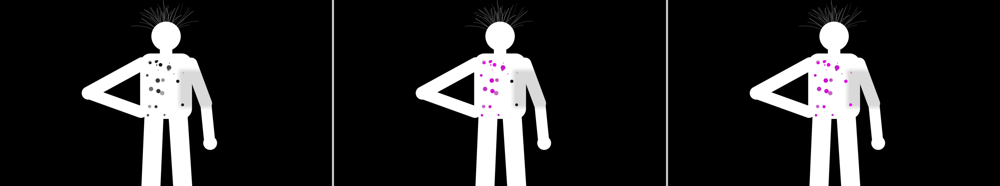

*Scene `holes`. Left: input. Middle: Fill Holes at its defaults, shown in the Show Changes view
(filled pixels in magenta): 17 holes filled; the gap between arm and body is larger than 1 % of
the frame and stays open. Right: Solid Above lowered to 0.79 (what Analyze Frame suggests here):
the holes next to the grey side face, which were not enclosed by solid matte at 0.95, fill too
(21 holes).*

### Solid Core

**What it does.** It makes everything deeper inside the matte than **Depth px** solid white,
fading in over **Feather px**. Use it for areas a key left semi-transparent that are joined to
the edge, so they are not holes: a grey side face, a dim area along the body.

**Never touches:** the outer Depth px of the edge, which stay exactly as they were. Real gaps,
meaning anything below Edge At, also keep a Depth px margin. It never darkens a pixel. The
frame edge does not count as an edge, so a subject cut by the frame is cored right up to it.

**When to use it:** after Fill Holes, when grey remains deep inside the subject. The Grey Inside
view shows exactly that, in red.

| Control | Default | Range | What it does |
|---|---|---|---|
| Enable | off | | Turns the operation on or off. |
| Depth px | 6 | 0-200 | The core starts this many pixels inside the edge. Smaller = more of the soft edge becomes solid. |
| Feather px | 2 | 0-50 | The core fades in over this many pixels after Depth, so its border is smooth. 0 = a hard core with a pixel staircase. |
| Edge At | 0.5 | 0.01-1 | The matte value the edge is measured from. |

Tips:
- Set Depth px a little wider than the soft edge you want to keep. With a wide soft edge (motion
  blur, defocus), raise Depth px or it gets cut into.
- **Watch for** areas that really are semi-transparent (glass, a veil, smoke): anything deeper
  than Depth px turns solid. That is why Solid Core is off by default.
- A hole below Edge At counts as edge, so Solid Core keeps a margin around it and does not
  close it. Fill the hole with Fill Holes first.


*Scene `holes`, crop of the torso at 2x, in the Grey Inside view (red = grey more than 4 px inside
the edge). Left: after Fill Holes with its defaults; the grey side face remains. Right: Solid Core
with its defaults added. Only thin lines next to the edges remain, inside the Depth px band that
is deliberately left alone. Around the one hole Fill Holes left open (black), the margin stays.*

### Contour Smooth

**What it does.** It takes the wiggle and chatter off the edge line, the small, fast waves a key
or a model leaves along an edge, while keeping the edge's softness and the real shape (corners,
creases, thin parts).

**Never touches:** anything away from the edge. Clean edges, round shapes, thin parts and hair
come out unchanged. The edge never moves farther than Max Shift px.

**When to use it:** a boiling or jagged edge line on an otherwise good matte. Contour Smooth
works on one frame at a time, so it calms the shape of the line in each frame but does not
remove flicker between frames.

| Control | Default | Range | What it does |
|---|---|---|---|
| Enable | off | | Turns the operation on or off. |
| Smooth px | 30 | 5-100 | Waves along the edge up to this length are removed. |
| Max Shift px | 1.5 | 0.25-3 | The edge never moves farther than this. Bigger deviations are taken to be real shape. |
| Corner deg | 20 | 10-90 | Turns sharper than this are corners and are kept. |
| Edge At | 0.5 | 0.05-0.95 | The matte value of the edge line that is smoothed. |

Tips:
- The effect is deliberately modest and safe. If a wiggle is larger than Max Shift px, Contour
  Smooth leaves it alone, because it treats it as shape.
- Creases that turn less than Corner deg soften slightly. Raise Corner deg on a subject with
  many shallow creases.
- On a matte that is grey or speckled almost everywhere, Contour Smooth does nothing (the
  debug log says "SKIPPED: noisy matte").


*Scene `chatter` (the left side's edge wiggles by ±1.2 px), crop of the upper arm at 6x; red line
= the true edge. Left: input. Right: Contour Smooth with its defaults. The line follows the true
edge more closely; the average error along the edge drops from 0.026 to 0.024. A small
improvement, as expected.*

### Shrink / Grow

**What it does.** It moves the edge outward (grow) or inward (shrink) by a sub-pixel amount,
while each part of the edge keeps its own softness: a 1 px edge stays 1 px, an 8 px soft edge
stays 8 px. A plain erode or dilate does not keep that softness.

**Never touches:** anything farther from the edge than the amount (plus a few pixels). Strands
narrower than about 3 px keep their shape. Grow never lowers a pixel, shrink never raises one.

**When to use it:** a matte that is consistently too small (a choked key, an eroded model matte)
or too big (a halo of background).

| Control | Default | Range | What it does |
|---|---|---|---|
| Enable | off | | Turns the operation on or off. |
| Grow (-Shrink) px | 1 | -20 to 20 | Pixels to move the edge outward; a negative value moves it inward. |

Tips:
- As with any grow or shrink, a gap or hole narrower than twice the amount closes when you grow,
  and a part narrower than twice the amount disappears when you shrink.
- **Growing pushes the edge over the old background.** The picture there still shows the
  background colour (a green edge on a green screen). Edge Colour Unmix handles this: when
  Shrink / Grow is on with a positive amount, its amount is added to Edge Colour Unmix's Ignore
  Outer px automatically.
- The 3 px strand limit is fixed; it does not change with resolution.

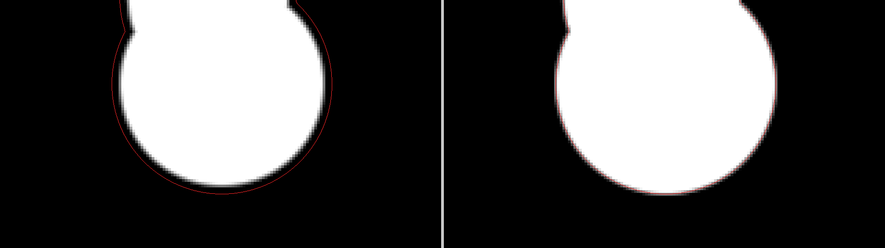

*Scene `eroded` (the whole matte is 3 px too small), crop of the hand at 6x; red line = the true
edge. Left: input. Right: Grow (-Shrink) px = 3. The edge now lies on the true edge with the
same softness (average error along the edge 0.328 → 0.003).*

### Edge Width

**What it does.** It gives the whole edge one consistent softness. Hard-cut (aliased) stretches
become soft, edges that are too soft get tighter. The edge's middle (the 0.5 line) stays where it
is, and the levels on either side are kept, for example a grey face behind the edge or hair
beyond it. Only the transition between them is reshaped into an even ramp.

**Never touches:** edges already within about 3 % of the target, parts and gaps narrower than
the target width (hair is not smeared or erased), anything away from the edge.

**When to use it:** a matte assembled from several sources with mixed edges, or a hard roto edge
that needs a defined softness.

| Control | Default | Range | What it does |
|---|---|---|---|
| Enable | off | | Turns the operation on or off. |
| Edge Width px | 2 | 0.5-16 | The edge's target width, from clear to solid. |
| Width Mix | 1 | 0-1 | 0 = the input edge, 1 = the target width. In between blends. |

Tips:
- A hard cut keeps a faint trace of its pixel staircase close to the steps. Turn on Contour
  Smooth as well (it runs before Edge Width) to clean that up.
- The ramp is centred on the 0.5 line, so half of Edge Width px lies outside it. A wide
  setting therefore reaches over the background by half its width. Check the edge colour, and
  use Edge Colour Unmix if a fringe appears.

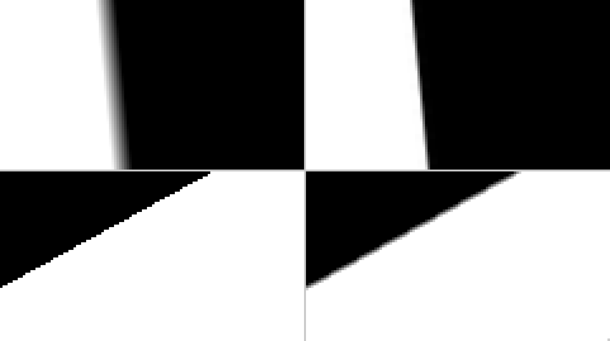

*Scene `mixed_edge`, crops at 8x. Top: the right arm's 8 px soft edge, input | Edge Width with its
defaults (2 px). Bottom: the hard-cut left side, input | the same setting: the staircase becomes
a 2 px ramp.*

### Snap to Image

**What it does.** It pulls an edge that is slightly off or blocky onto the edges in the picture,
using the picture's local colour. It works only near the matte's edge.

**Never touches:** anything farther than Band px from the edge. Where the picture is flat (no
edge to follow), the matte is kept.

**Needs** the picture on the front input, the same size as the matte.

**When to use it:** a matte from a low-resolution or blocky source (a model run at reduced size),
or one that is shifted by a pixel or two against the picture.

| Control | Default | Range | What it does |
|---|---|---|---|
| Enable | off | | Turns the operation on or off. |
| Radius px | 8 | 1-32 | The size of the window the picture is compared in. Larger follows bigger offsets but blurs small detail. |
| Band px | 12 | 0-64 | Changes reach this far from the edge (or from a soft, sloped area of the matte). |
| Detail | 0.5 | 0-1 | Higher follows weaker picture edges. Lower if it locks onto texture. |
| Edge From Picture | 0.35 | 0-1 | 0 = keep the matte's own softness, 1 = take the softness from the picture. |

Tips:
- It is only as good as the picture's edge. Low contrast between subject and background, motion
  blur, or a background with strong texture next to the edge can pull the matte the wrong way.
  Lower Detail, or reduce Band px.
- A faint soft tail can remain just outside a badly placed edge (visible in the image below).
  Clean & Crush runs before Snap to Image, so it cannot remove that tail. A second Matte Refine
  node after this one, with Clean & Crush on, can.
- It was designed for a scene-linear picture and adjusts to the picture's brightness, so
  exposure does not change how strongly it pulls. Unlike Edge Colour Unmix, it does not check
  the colourspace.

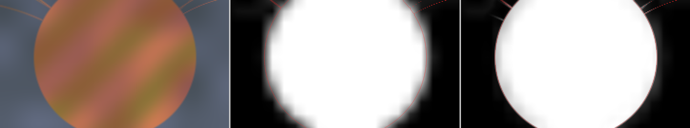

*Scene `coarse` (a blocky 12 px matte shifted 2 px right), crop of the head at 4x; red line = the
true edge. Left: the picture. Middle: input matte. Right: Snap to Image with its defaults. The
edge follows the head's outline (average error near the edge 0.248 → 0.113). A faint soft tail
remains just outside.*

### Edge Colour Unmix

**What it does.** It removes the old background's colour from the soft edges of the **picture**
(the RGB), so that the subject comped over a new background with the matte has no fringe or
halo. It estimates the clean colour of the subject in every soft edge pixel. It changes the
picture, never the matte. Its result is shown in the **Picture** view, and it is what the image
output carries in that view.

**Never touches:** the matte; solid pixels of the subject (alpha 1) keep their exact picture
colour, apart from the outer Ignore Outer px. Pixels that are fully clear (alpha 0) get the
subject's colour extended outward instead of the old background, so a later blur cannot pull
the background back in.

**Needs** the picture on the front input, and **the picture must be scene-linear**. Unmixing is
only correct in linear light. While it is on, the node checks the picture's colourspace in Flame's
colour management. If the picture is log, video or unknown, the footer shows an **error**, for
example *Edge Colour Unmix needs a scene-linear picture; the front input is ACEScct (log).
Convert it to linear first.* The node still renders, but the result is wrong. Convert to
linear before the node (and back after it if needed).

**When to use it:** green or blue spill in hair and soft edges, a dark or bright fringe from the
old background, after growing a matte.

| Control | Default | Range | What it does |
|---|---|---|---|
| Enable | off | | Turns the operation on or off. |
| Edge Smoothness | 0.005 | 0.0001-0.5 | Higher = flatter subject colour in the edge (less detail taken from the picture). |
| Extend px | 3 | 0-20 | Also solves this far beyond the soft edge, on both sides. |
| Ignore Outer px | 3 | 0-20 | The colour is estimated only from pixels at least this deep inside the edge, so a matte that is too big (a green rim) still unmixes. Shrink / Grow's amount is added when it is on. |
| Mix | 1 | 0-1 | 0 = the picture, 1 = the clean colour. |

Tips:
- **A green rim on a solid-looking edge** means the matte reaches over the old background. Raise
  Ignore Outer px to the amount the matte is too big plus about 1 px. Growing inside this node is
  accounted for automatically; growing done elsewhere is not.
- **Watch for** thin parts (a strand, a finger) narrower than about twice Ignore Outer px: they
  keep their own colour, so a green strand stays green there.
- A larger Ignore Outer px costs a little colour accuracy on a clean matte. Keep it small when
  the matte is right.


*Scene `fgcolor` (soft hair over a saturated green screen), crop of the head at 4x, both comped
over a new neutral grey with the same matte. Left: the original picture: green hair and a green
rim. Right: after Edge Colour Unmix with its defaults: the hair takes the subject's colour. The
green error in the soft edge against the true colour drops from 0.187 to 0.004.*

### Analyze Frame

A button in the **Matte** column. It looks at the current frame's matte and **sets Clean & Crush,
Fill Holes (including the Closed edges) and Solid Core** for it. A message then lists, one line
per decision, what it chose and why. The edge and colour operations are not touched.

What it decides:

- **Solid Above**: just below the subject's solid level, above the grey of the defects. If the
  default 0.95 already fills nearly as much, it keeps 0.95.
- **Max Hole %**: between the largest hole and the smallest area that looks like a real gap,
  when there is a clear jump in size between the two.
- **Closed edges**: for the frame edges the subject is cut by, but only when there are holes to
  fill.
- **Bridge Gaps px**: only if holes leak out through narrow cracks.
- **Solid Core**: turned on only when grey remains more than 8 px inside the subject after
  filling, with Depth px from how far in the grey starts.
- **Clean & Crush**: turned on when there are islands or background haze.

It checks its suggestion by running the operations on the frame. When a note ends with
"Left: N", N is how many grey pixels deep inside the subject remain after them.

Example message (scene `all`):

> - Clean & Crush on: 29 small islands outside the subject (up to 0.022 % of the frame) and background haze up to 0.09 in 58 % of the background.
> - Max Island % 0.050 (default): removes the 29 islands (largest 0.022 %); 2 larger pieces (0.099-0.14 %) are kept as separate objects: raise Max Island % above 0.14 to remove them too.
> - Crush Beyond px 4 (default): everything farther outside the edge goes to 0; the subject's own falloff ends about 2 px out.
> - Solid Above 0.79: 21 holes (values 0.06-0.73) fill; anything from 0.64 to 0.91 fills about as much; above 0.92 less fills.
> - Max Hole % 0.22: the holes are at most 0.047 % of the frame; 2 enclosed areas of 1.0 % or more look like real gaps (e.g. an arm on a hip) and stay open.
> - Bottom Closed on: the subject is cut by this frame edge, so holes reaching it fill too (none does in this frame); ...
> - Bridge Gaps px 0 (default): no hole leaks out through a narrow gap. Rim px 1 (default).
> - Solid Core on, Depth px 4: 25054 pixels below 0.9 remain more than 8 px inside the subject after Fill Holes (a semi-transparent area joined to the edge); the edge's own softness reaches about 2 px in, so the outer 4 px stay as they are. Left: 0. Check see-through parts (glass): they turn solid too.

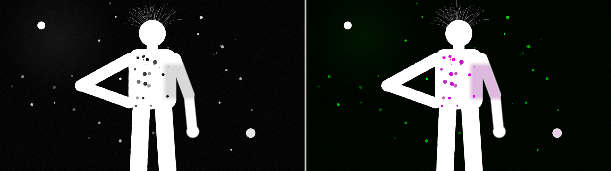

*Scene `all`. Left: input. Right: the result with the settings Analyze Frame chose, in the Show
Changes view: filled holes and the cored grey face in magenta, the removed islands and the
crushed haze in green.*

How to read it, and its limits:
- It **refuses**, and changes nothing, on a matte that is constant (nothing connected), has
  almost no subject, is grey or speckled almost everywhere, or is tiny. The message says which.
- It analyses **one frame**. Check a few other frames, especially ones where the subject touches
  the frame edge differently.
- It cannot tell see-through parts (glass) from grey defects, a real small pocket from a hole
  when their sizes do not differ, or an object from debris. Read the notes: they say what it
  assumed.
- Analyze Frame sets ordinary controls. Change any of them afterwards as you like, and press
  the button again to start over.

### View

**View** (in the Matte column, on both tabs) picks what the **image output** shows. The matte
output is always the refined matte.

| View | Shows |
|---|---|
| **Picture** (default) | The front input passing through, with Edge Colour Unmix's clean edge colour when that is on. Without a picture: the refined matte. |
| **Show Changes** | The input matte in grey; raised pixels tinted **magenta**, lowered pixels **green**. |
| **Matte** | The refined matte as grey. |
| **Trimap** | Solid (≥ 0.98) white, clear (≤ 0.02) black, everything between mid grey: where the matte is soft. |
| **Grey Inside** | Semi-transparent pixels more than 4 px inside the edge, in red: what Solid Core is for. |

The image output is tagged with the right colourspace for Flame: the picture keeps its own, and
a matte shown as RGB is tagged as a matte, so it is not run through a viewing transform.

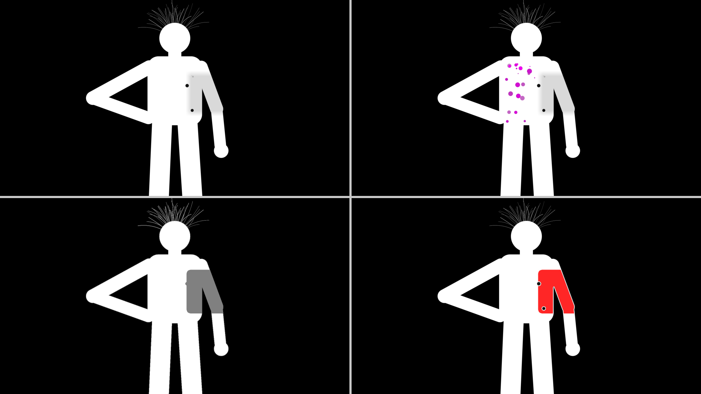

*Scene `holes` after Fill Holes with its defaults: Matte | Show Changes (top), Trimap | Grey Inside
(bottom).*

### Support

The **Support** column holds **Debug Logging** (per user, adds per-frame timings and settings to
the log), **Collect Logs** (writes `~/matte-refine-support-<date>.tar.gz` with the logs and system
details, no images; review it before sending), and **Save Matte** (writes the current frame's
input matte to `~/.cache/matte-refine/dumps/` for analysis; it stays on your machine unless you
send it). The **Version** label in the Matte column shows which build is loaded. The log is
`~/.cache/matte-refine/logs/matte-refine.log`.

---

## 3. Matte Refine ML: the operations

**Requirements:** Rocky Linux with an NVIDIA GPU, and the model files installed in the model
folder (see the install notes). It is not available on macOS yet. Without a usable GPU it falls
back to the CPU, about ten times slower, and says so in the footer.

**The first frame is slower.** The first frame after Flame starts takes a few seconds while the
models load (expected 3-4 s with Smart Fill on; Edge Refine alone about 1 s). After that, a frame takes about
0.1-0.3 s at HD. The models run in a separate helper program shared by all Matte Refine ML
nodes, so Flame itself stays responsive. If that program fails, the node passes the matte
through unchanged, says why in the footer, and tries again on the next frame.

### Matte column

| Control | Default | What it does |
|---|---|---|
| View | Picture | What the image output shows (below). |
| Picture Colour | Auto | **Auto**: Flame converts the picture to Rec.709 display before the models see it. The models were trained on ordinary video pictures, so this suits log, linear and video sources alike. **Bypass**: the picture is used exactly as it arrives. Use it if your picture is already a display-referred video image, or to compare. The matte is not affected either way. |
| Version | | The loaded build. |

| View | Shows |
|---|---|
| **Picture** (default) | The front input. With Auto, the picture as converted for the models. |
| **Matte** | The refined matte as grey. |
| **Trimap** | What Edge Refine uses: solid core white, the edge band it re-solves grey, clear background black. |
| **Changes** | The input matte in grey; added alpha **green**, removed alpha **magenta**. *Note: these are the opposite colours of Matte Refine's Show Changes view.* |
| **Holes** | The refined matte in grey; holes Smart Fill filled in **green**, holes it kept as real gaps in **red**. |

### Smart Fill

**What it does.** It fills holes like Fill Holes does, but decides **for each hole** whether it is
a defect (fill it) or a real gap (keep it), instead of going by size. Two judges must agree before
a hole is filled. One is a segmentation model (BiRefNet), which says how much the hole's area
looks like part of the subject. The other is the picture's colour inside the hole, compared
with the subject around it and with the background nearby. A hole is filled only when both say
"subject".

**Never touches:** everything except the holes it fills (with 1.0) and a 1 px rim around them.
The model is only a vote; it never paints matte values itself.

**When to use it:** defects and real gaps of similar size in the same matte (a gap under the
arm, a ring held in a hand, an earring), where Fill Holes' Max Hole % either fills the gaps or
leaves the defects.

| Control | Default | Range | What it does |
|---|---|---|---|
| Enable | off | | Turns the operation on or off. |
| Subject Threshold | 0.6 | 0-1 | A hole is filled only when the picture and the segmentation both say "subject" at least this much. Higher keeps more holes open: 0 fills every hole up to Max Hole %, 1 keeps them all. Use it to overrule the model on a shot. |
| Max Hole % | 10 | 0-100 | Holes larger than this share of the frame are never filled. 0 = no limit. |
| Segmentation | Lite | Lite / Full | Lite: faster. Full: about 2x slower, more reliable on low-contrast pictures. |

Tips and limits:
- A hole here is the same as in Fill Holes at Solid Above 0.95: an area below 0.95 enclosed by
  solid matte. Solid Above is fixed, and there are no Bridge Gaps or Closed frame edges. A hole
  that touches the frame edge, or leaks out through a crack, is not seen. Use Matte Refine's
  Fill Holes for those.
- When the subject and the background look alike (no colour contrast), the model does not see
  the subject and nothing is filled. The node fails safe: holes stay as they were.
- On a low-contrast picture, Full is clearly more reliable than Lite.
- Check the **Holes** view: green was filled, red was kept.
- It has been tested on synthetic scenes; how well it does on real footage is not yet proven.

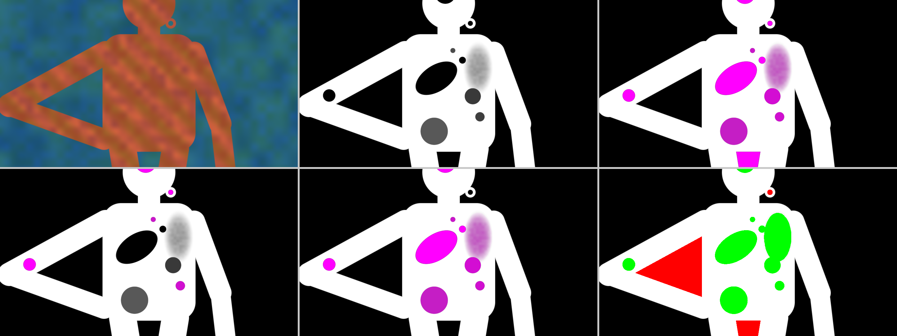

*Scene `gaps` (10 defect holes to fill and 5 real gaps to keep, of overlapping sizes), crop of the
upper body at 1x. Top: picture | input | Matte Refine's Fill Holes at its defaults (Show Changes,
magenta = filled): it fills every defect but also the earring and the gap between the legs (41 %
of the real-gap pixels). Bottom: Fill Holes with Max Hole % 0.2: the real gaps mostly stay open
but only 25 % of the defect pixels are filled | Smart Fill at its defaults (Segmentation Lite):
every defect filled, no real gap | its Holes view (green = filled, red = kept).*

### Edge Refine

**What it does.** It re-solves the edge of the matte with a matting model (ViTMatte) that looks
at the picture. The node builds a trimap from your matte: a **solid core**, a **band around the
edge** that the model re-solves, and **clear background**. The band reaches Band px either side
of the matte's edge. The model's result is blended in at full strength in the middle of the
band and fades out towards its border, so there is no seam.

**Never touches:** anything outside the band. The core and the background are exactly your input
matte. Turn on **Only Grey** to also keep every pixel that was solid or clear in the input.

**When to use it:** an edge that is blocky, shifted, too hard or too soft compared with the
picture; a model or roto matte whose outline is roughly right but whose edge detail is wrong.

| Control | Default | Range | What it does |
|---|---|---|---|
| Enable | **on** | | Turns the operation on or off. It is on as soon as you add the node. |
| Band px | 10 | 1-64 | The model re-solves this many pixels either side of the matte's edge. |
| Outer px | 0 | 0-256 | The band reaches this many pixels **further outside** the matte's edge, where hair strands that the matte lost can be found again. For hair: about 100-150. 0 = the same on both sides. |
| Mix | 1 | 0-1 | 0 = the input matte, 1 = the model's edge. |
| Only Grey | off | | Change only pixels that were grey (0.02-0.98) in the input matte. |

The **Model** choice is in the **Model & Support** column: **Small** (default, faster) or
**Base** (about 1.2x slower).

Tips and limits:
- Make the band wide enough to cover how far your matte's edge is off, but not wider. A wider
  band gives the model more room to make mistakes and costs time.
- **Hair: use Outer px.** The model only works inside the band, and strands lie outside the
  matte's edge. A wider Band px does little for hair (the band is symmetric, so it also reaches
  into the subject). **Outer px** extends the band only outwards. On the synthetic hair scenes,
  Outer px 100-150 brings back about five times more of the lost strand alpha than the default
  (about 0.67 against 0.13 of it), for about 25 % more time per frame. The model does not
  rebuild everything: a part of every strand stays lost. Above about 190 px it starts to paint
  spill on busy backgrounds. Keep Outer px at 0 for mattes whose edge is already clean: it makes
  those slightly worse.
- It can make an edge that was already clean slightly worse, and on the synthetic scenes it can
  leave faint ghost lines just outside the edge (visible in the image below). Compare with Mix,
  or with Snap to Image in Matte Refine, which needs no GPU.
- Band px and Outer px are in pixels of the frame. For UHD material made from an HD matte you may
  want roughly double the Band px. Keep Outer px at or below about 150 at any resolution.
- How good it is on real footage depends on the shot. The synthetic scenes measure the geometry
  of the edge, not real hair.

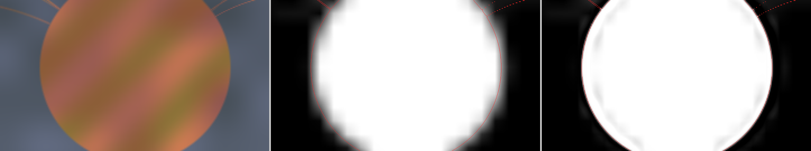

*Scene `coarse`, the same crop as Snap to Image above; red line = the true edge. Picture | input |
Edge Refine (Model Small, Band px 10, Mix 1). Average error near the edge: input 0.248, Snap to
Image 0.113, Edge Refine 0.049. Note the faint ghost lines just outside the head.*

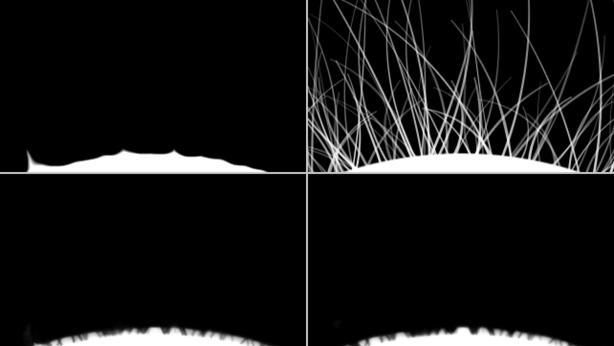

*Scene `hair_flat` (260 fine strands lost in a coarse, eroded matte), crop above the head at 3x.
Top: input matte | the truth. Bottom: Edge Refine at Band px 10 | at Band px 30. The head's
outline is restored and short stubs appear at the scalp, but the strands themselves are not
recovered: about 13 % of the lost strand alpha comes back, the same at both band widths.*

### Temporal

**What it does.** It calms flicker between frames. For each frame it looks at the neighbouring
frames, lines them up with the subject's motion (optical flow on the picture), and replaces the
matte's edge band with a weighted median of the aligned neighbours. A hole that comes and goes
is decided by a majority vote over the frames. It is classical: no model, no GPU.

**Never touches:** anything outside the edge band, and holes are never punched into a solid
matte. The current frame's matte stays the source.

**When to use it:** a matte made frame by frame (an AI generator or a keyer) whose edge jitters
or speckles from frame to frame, or whose holes flicker. It needs the picture, because the
motion is measured on it.

| Control | Default | Range | What it does |
|---|---|---|---|
| Enable | off | | Turns the operation on or off. |
| Frames | +-1 frame | +-1 / +-2 frames | How many neighbours each side. +-2 smooths more and costs about twice as much. |
| Strength | 1 | 0-1 | 0 = the input, 1 = the full effect. |
| Band px | 6 | 1-32 | The width of the edge band that is smoothed. |

Tips and limits:
- Runs first, before Smart Fill and Edge Refine, so they work on the calmer matte.
- On the synthetic jitter scene (HD), +-1 frame cut the edge flicker by about 55 % and +-2 frames
  by about 70 %; fast motion (tens of pixels per frame) still helped and never made it worse.
  Real footage with motion blur, occlusion and cuts has not been measured yet.
- At the first and last frame of a clip there are fewer neighbours; with none, the matte passes
  through and the footer says so.
- A hole that is open in about half the frames is often kept open: the vote needs a majority.
- It costs about 75 ms (+-1) or 130 ms (+-2) per HD frame on top of the other operations, plus
  the time Flame needs to hand over the neighbour frames.

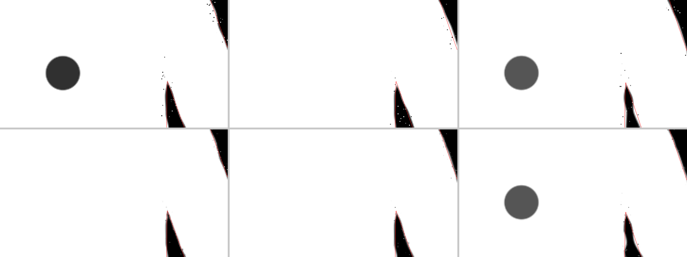

*Scene `temporal` (9 frames; per-frame edge jitter, speckle near the edge, and a hole
that comes and goes), frames 1-3 at 3x, following the subject; red line = the true edge. Top:
input. Bottom: stabilised with one neighbour frame on each side. The speckle and jitter calm
down. The hole in frame 1 is filled because both neighbours are solid there. Frame 3 keeps its
hole, because frame 4 has it too.*

### Model & Support

**Model** (Small / Base, Edge Refine's model), **Debug Logging** and **Collect Logs**, as in
Matte Refine. The log is shared with Matte Refine. Matte Refine ML has no Save Matte button.

---

## 4. Try it yourself: the test scenes

The test scenes are simple drawn figures. Each one has a known defect and the **true, clean
matte**, so you can see exactly what an operation fixes. **The scene files are in the release
package (folder `scenes/`), not in the git repository**: at HD each EXR is about 25 MB. The
repository contains the generator, `mr_synth`, and the previews below.

Make them yourself (from a build of this repository):

```
mr_synth <folder> [WxH] [scene ...]     # default 1920x1080, every scene
mr_synth ~/scenes 1920x1080 holes gaps  # only these two
```

Files per scene:

| File | What it is | Where it goes in Flame |
|---|---|---|
| `<scene>_rgb.exr` | the picture | the front input |
| `<scene>_matte.exr` | the input matte with the defect, as grey RGB | Matte Refine: the Matte input (or the source alpha). Matte Refine ML: the source alpha socket |
| `<scene>_truth.exr` | the clean matte | compare against the result |
| `<scene>_fg.exr` | the true subject colour (`fgcolor`, `hair_flat`, `hair_busy`) | compare with Edge Colour Unmix |
| `<scene>_label.exr` | `gaps` only: black background, dark grey subject, light grey defect hole, white real gap | which holes should fill |
| `<scene>_matte.f32` + `.txt` | the matte as raw floats, as Save Matte writes it | analysis outside Flame |
| `scenes.txt` | what each scene contains | |

The `temporal` scene is a 9-frame sequence: `temporal_rgb.0000.exr` to `temporal_rgb.0008.exr`,
and the same for `temporal_matte` and `temporal_truth`. The frame number comes last, so **each
kind (rgb, matte, truth) imports into Flame as one 9-frame sequence**. `temporal_motion.txt`
holds the true motion per frame.

How to use them in Flame:

1. Import `<scene>_rgb.exr`, `<scene>_matte.exr` and `<scene>_truth.exr` into Batch.
2. Connect them as in the table and section 1.
3. Turn on the operation for the scene's defect, and switch View between Matte, Show Changes and
   the others.
4. Compare the result with the truth: a Difference (or Comp in Difference mode) between the
   node's matte output and `_truth` shows what is left.

The pictures are plain values without a colourspace of their own. Tag them as scene-linear when
you try Edge Colour Unmix, or it reports the colourspace error.

| Scene | Contains | Try |
|---|---|---|
| `holes` | grey holes inside the torso, a grey (0.85) side face, a real gap between arm and body that must stay open | Fill Holes, Solid Core, Analyze Frame |
| `specks` | islands and debris outside the figure, background haze up to about 0.1 | Clean & Crush |
| `chatter` | the left side's edge wiggles (±1.2 px, about 15 px apart) | Contour Smooth |
| `mixed_edge` | hard-cut (aliased) left side, a 1 px head, an 8 px soft right arm, 2 px elsewhere | Edge Width, Contour Smooth |
| `eroded` | the whole matte 3 px too small, with its softness kept | Shrink / Grow, Edge Refine |
| `coarse` | a blocky (12 px) matte, shifted 2 px right, over a picture with the true edge | Snap to Image, Edge Refine |
| `fgcolor` | a clean matte with soft hair over a saturated green background | Edge Colour Unmix |
| `all` | all defects together: holes, grey face, specks, haze, chatter, mixed edges | the whole chain, Analyze Frame |
| `gaps` | 10 defect holes to fill and 5 real gaps to keep (arm on hip, between the legs, a ring in the hand, a small linked ring, an earring), sizes overlapping; a grey wash on the torso | Smart Fill vs Fill Holes |
| `hair_flat` | a head and shoulders with 260 fine strands (1-3 px) lost in a coarse, eroded matte; flat background | Edge Refine (and its hair limit) |
| `hair_busy` | the same subject and mattes over a busy, saturated background | Edge Refine on a hard picture |
| `temporal` | 9 frames: a moving figure, per-frame edge jitter, speckle near the edge, a hole that comes and goes | flicker (Temporal) |

Previews (picture | input matte | truth):

| | |
|---|---|
| `holes` 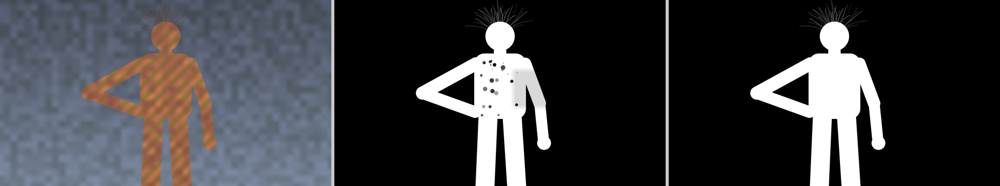 | `specks` 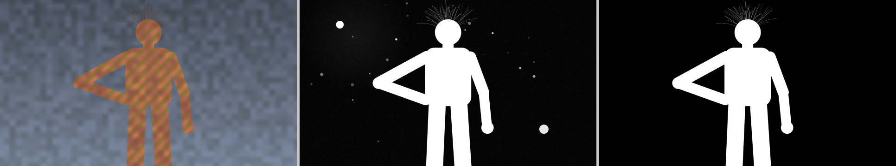 |
| `chatter`  | `mixed_edge`  |
| `eroded` 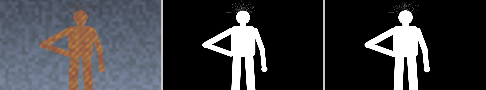 | `coarse` 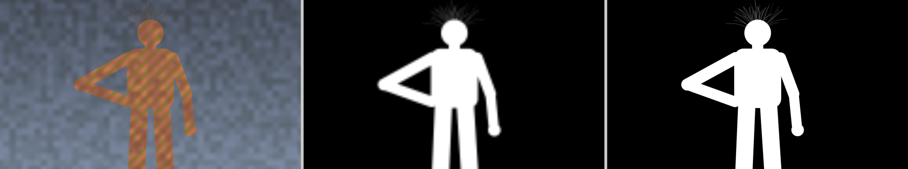 |
| `fgcolor` 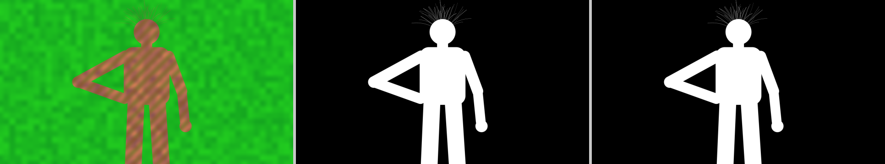 | `all` 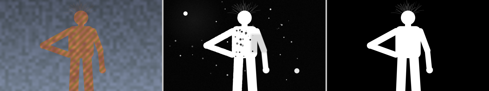 |
| `gaps` 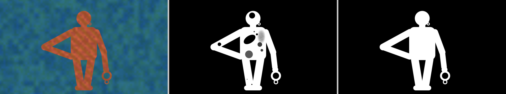 | `hair_flat` 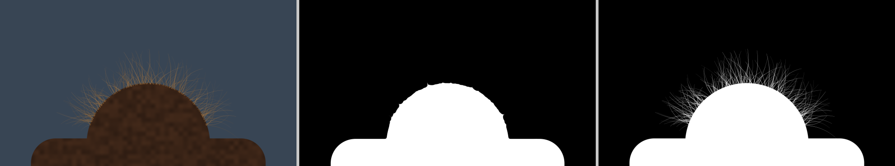 |
| `hair_busy` 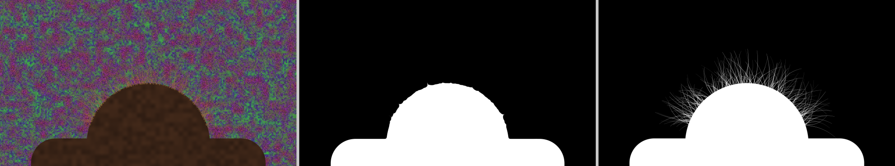 | `temporal`, frame 0 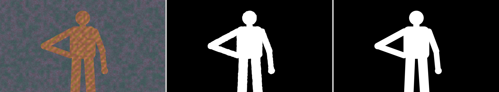 |

---

## 5. Which operation do I need?

| Symptom | Operation | Node |
|---|---|---|
| Holes or spots inside the subject | Fill Holes (check Solid Above first) | Matte Refine |
| Holes, but also real gaps of the same size that must stay open | Smart Fill | Matte Refine ML |
| A real gap (under an arm, between the legs) got filled | Lower Max Hole % in Fill Holes, or use Smart Fill | Matte Refine / ML |
| Holes at a frame edge where the subject is cut off | Fill Holes Edges (Left / Right / Top / Bottom Closed) | Matte Refine |
| A grey, semi-transparent area inside the subject, joined to the edge | Solid Core | Matte Refine |
| Specks, islands or debris in the background | Clean & Crush (Max Island %) | Matte Refine |
| A grey haze or veil in the background | Clean & Crush (Crush Beyond px) | Matte Refine |
| A jagged, wiggly or chattering edge line | Contour Smooth | Matte Refine |
| The matte is too small or too big all round | Shrink / Grow | Matte Refine |
| The edge is too hard (aliased) or too soft, or mixed | Edge Width | Matte Refine |
| The edge does not follow the picture (blocky, shifted) | Snap to Image; for more, Edge Refine | Matte Refine / ML |
| The edge detail is wrong compared with the picture | Edge Refine | Matte Refine ML |
| A green or blue fringe, spill or halo in the soft edges | Edge Colour Unmix (scene-linear picture) | Matte Refine |
| A green rim after growing the matte | Edge Colour Unmix, Ignore Outer px | Matte Refine |
| Lost hair strands | Not recovered by any operation yet: Edge Refine restores the edge, not missing strands. Planned: Matte Merge with an LTX hair matte | |
| Flicker between frames | Temporal | Matte Refine ML |
| Not sure where to start | Analyze Frame, then read its message | Matte Refine |
